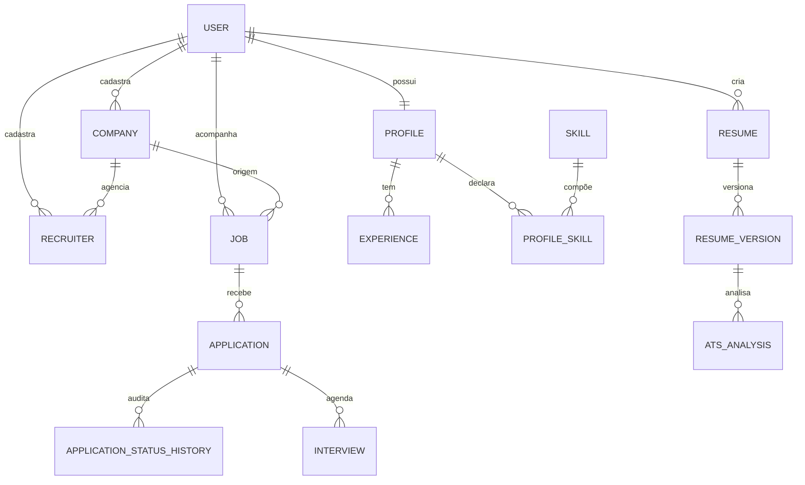
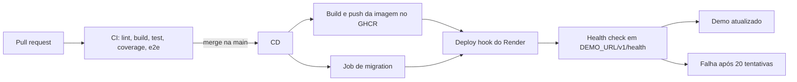

# Kandid

**API REST para organizar a busca por emprego: perfil estruturado, currículos versionados, análise ATS determinística e pipeline de candidaturas.**


## Visão geral

Quem procura emprego costuma espalhar informações entre planilhas, currículos em
pastas, e-mails e anotações. O resultado é perda de contexto, versões conflitantes
de currículo e pouca visibilidade sobre o que está funcionando no processo.

O Kandid propõe centralizar esse fluxo em uma única API:

- perfil profissional estruturado, com experiências, skills, formação,
  certificações e idiomas;
- currículos com versões imutáveis, geradas a partir do perfil;
- análise de aderência a uma vaga com motor ATS determinístico e explicável;
- candidaturas com status, histórico auditável, entrevistas e valores
  propostos/ofertados;
- métricas de funil e de compensação.

É um projeto **pessoal, de estudo e portfólio**, sem objetivo comercial. A
especificação completa do domínio está em [`docs/prompt-kandid.md`](docs/prompt-kandid.md).

> **Estado atual:** a Sprint 1 (autenticação) está concluída, com PR pendente. A
> Sprint 2 (perfil profissional) foi implementada e validada localmente na branch
> `feat/sprint-2-profile` (HEAD `00b0647`): perfil, experiências com bullets,
> skills, formação, certificações e idiomas estão funcionais, sem HTTP 501 nas
> rotas do domínio. A Sprint 3 (pipeline) também foi implementada localmente nessa
> mesma branch: empresas, recrutadores e vagas com stack, senioridade, faixa
> salarial, filtros e paginação. A Sprint 4 (candidaturas) também foi
> implementada localmente nessa mesma branch: máquina de estados, histórico,
> compensação, filtros e paginação. Commit e push dependem de aprovação humana;
> PR, revisão, CI, testes e demo manual das Sprints 3 e 4 também estão pendentes.
> Currículos e ATS ainda não foram implementados. Os workflows de
> CD e Dependabot seguem ativos e sem alteração, com a decisão sobre o ambiente
> demo registrada como pendência. Consulte [Status atual](#status-atual) e
> [Roadmap](#roadmap-por-sprints).

## Escopo do MVP

O escopo abaixo é o alvo do MVP definido na spec. A implementação é incremental,
por sprint.

### Dentro do escopo

- Autenticação simples com JWT: registro, login e `GET /me`.
- Perfil, experiências com bullets, skills, formação, certificações e idiomas.
- Empresas (cliente ou agência), recrutadores e vagas.
- Candidaturas com máquina de estados, histórico append-only e entrevistas.
- Currículos com versões imutáveis em snapshot JSON.
- Motor ATS determinístico, sem IA, com score e breakdown explicáveis.
- Export do currículo em JSON e HTML.
- Dashboard com funil, taxa de resposta e comparativo proposto × ofertado.
- Seed do catálogo de skills e seed de demonstração.
- Swagger, migrations, Docker Compose e documentação.

### Fora de escopo

- Geração de PDF ou DOCX.
- Integração com LLM ou qualquer recurso de IA.
- Billing, planos, multi-tenant, convites ou times.
- Upload e armazenamento de arquivos.
- Importação de currículo existente.
- Parsing automático de vaga por URL.
- Roles e permissões além de "usuário autenticado".
- Telemetria da aplicação.

## Stack e decisões técnicas

| Camada | Escolha |
|---|---|
| Runtime | Node.js 24 (CI e imagem Docker) |
| Framework | NestJS 12 |
| Linguagem | TypeScript strict, ESM (`"type": "module"`, imports relativos com `.js`) |
| Persistência | TypeORM 1.1.2 com driver `mysql2` |
| Banco | MySQL 8.4 (Docker Compose local e service container no CI) |
| Documentação | Swagger/OpenAPI em `/docs` |
| Validação | `class-validator` + `class-transformer` com `ValidationPipe` global |
| Testes | Vitest + supertest |
| Qualidade | oxlint type-aware + Prettier |
| Entrega | Docker multi-stage, GHCR, GitHub Actions e Render (demo pendente) |

Decisões que moldam o código:

- **ESM**: todo import relativo termina em `.js`; não há `require()`.
- **Prefixo global `/v1`**: a API fica em `/v1`; o Swagger fica em `/docs`.
- **Schema versionado**: `synchronize: false` e migrations versionadas. Em
  ambiente remoto, migrations são forward-only.
- **Configuração validada no boot**: o `ConfigModule` valida as variáveis de
  ambiente e falha cedo se algo estiver incorreto. `DATABASE_URL` tem prioridade
  sobre `DB_*`, e `JWT_SECRET` precisa ter pelo menos 16 caracteres.
- **Erros com formato único**: `{ statusCode, error, message, path, timestamp }`
  via filtro global de exceções.
- **Domínio escopado por usuário**: toda consulta de domínio deve usar o
  `user_id` do usuário autenticado; `user_id` nunca é aceito no body.
- **Dinheiro em centavos**: valores monetários usam `bigint`, sempre acompanhados
  de `currency` e `salary_period`.
- **Imutabilidade**: `resume_version` e `application_status_history` não sofrem
  `UPDATE`; versões e histórico são registros append-only.
- **ATS determinístico**: o score é calculado por regras explícitas e testáveis,
  com pesos, checks estruturais e keywords encontradas/ausentes. Não há IA.

## Arquitetura

Monólito modular em NestJS. Hoje a aplicação tem a fundação, a autenticação e os
domínios de perfil, pipeline e candidaturas implementados localmente:

- `main.ts` configura o prefixo `/v1`, o `ValidationPipe`, CORS, o Swagger e a
  porta;
- `app.module.ts` carrega configuração validada, TypeORM, health, users, auth,
  perfil, pipeline (companies, recruiters e jobs) e candidaturas (applications);
- `database/data-source.ts` é o `DataSource` usado pelo CLI do TypeORM, com
  entidades e migrations carregadas por glob;
- `database/migrations/1794182400000-CreateUsers.ts` cria a tabela `users`;
- `database/migrations/1794268800000-CreateProfileDomain.ts` cria as tabelas do
  domínio de perfil (`profiles`, `experiences`, `experience_bullets`, `skills`,
  `profile_skills`, `educations`, `certifications` e `languages`);
- `database/migrations/1794960000000-CreatePipelineDomain.ts` cria `companies`,
  `recruiters`, `jobs` e `job_skills`, com `jobs.company_id` em `RESTRICT`;
- `database/migrations/1795046400000-CreateApplicationsDomain.ts` cria
  `applications` e `application_status_history` (tabela no singular);
- `health` executa `SELECT 1` para reportar o estado do banco;
- `modules/users` contém a entidade `User` (tabela `users`) e o `UsersService`;
- `modules/auth` contém `AuthController`, `AuthService`, DTOs e a emissão de JWT;
- `modules/profiles` contém o perfil 1:1 do usuário (`profiles`);
- `modules/experiences` contém experiências e bullets aninhadas
  (`experiences` e `experience_bullets`);
- `modules/skills` contém o catálogo global (`skills`), os vínculos do perfil
  (`profile_skills`) e os controllers `SkillsController` e
  `ProfileSkillsController`;
- `modules/educations`, `modules/certifications` e `modules/languages` cobrem as
  demais seções do perfil;
- `modules/companies`, `modules/recruiters` e `modules/jobs` implementam o
  pipeline da Sprint 3, com stack em `job_skills` e faixa salarial em centavos;
- `modules/applications` implementa a máquina de estados (`ApplicationStatus` e
  `APPLICATION_TRANSITIONS`), o histórico append-only, a compensação e os filtros
  da Sprint 4, com serviço transacional;
- os controllers do domínio estão roteados, com guard JWT e Swagger; os services
  implementam as regras de negócio das Sprints 2, 3 e 4, sem
  `NotImplementedException` (HTTP 501) nas rotas de perfil, pipeline e
  candidaturas;
- `common/utils` concentra os helpers puros de conversão e normalização; o PATCH
  usa `hasField` para distinguir campo ausente de `null`, e a leitura de `DATE`
  usa `extra: { dateStrings: ['DATE'] }` em `app.module.ts` e `data-source.ts`
  (decisões em [`ADR 0002`](docs/adr/0002-sprint-2-profile.md)); o pipeline e a
  resolução de conflitos de contrato estão em
  [`ADR 0003`](docs/adr/0003-sprint-3-pipeline.md); as candidaturas estão em
  [`ADR 0004`](docs/adr/0004-sprint-4-applications.md);
- `common/filters` concentra o filtro global de erros;
- `common/guards` tem o `JwtAuthGuard`, implementado sem passport;
- `common/decorators` tem o `@CurrentUser()`;
- `common/interfaces` define o usuário autenticado;
- `common/validators` tem o `IsDateOnly`, que exige datas estritas `YYYY-MM-DD`;
- `common/utils` concentra a normalização de e-mail.

Novos módulos seguem o padrão `dto/`, `entities/`, `*.module.ts`,
`*.controller.ts`, `*.service.ts` e `*.spec.ts`.

```text
Kandid/
├── .github/
│   ├── workflows/
│   │   ├── ci.yml
│   │   ├── cd.yml
│   │   └── codeql.yml
│   ├── CODEOWNERS
│   ├── dependabot.yml
│   └── pull_request_template.md
├── .opencode/
│   ├── agents/                  # 8 agentes do time
│   └── commands/                # /sprint-plan, /feature, /test, /review, /release, /retro
├── docs/
│   ├── adr/
│   │   ├── 0001-database.md
│   │   └── 0002-sprint-2-profile.md
│   ├── sprints/
│   │   ├── sprint-00.md
│   │   ├── sprint-01.md
│   │   └── sprint-02.md
│   ├── backlog.md
│   ├── prompt-kandid.md         # spec e fonte da verdade do domínio
│   ├── runbook-deploy.md
│   └── workflow.md
├── kandid_api/
│   ├── src/
│   │   ├── common/
│   │   │   ├── decorators/
│   │   │   ├── enums/              # enums do domínio (seniority, skill, etc.)
│   │   │   ├── filters/
│   │   │   ├── guards/
│   │   │   ├── interfaces/
│   │   │   ├── utils/
│   │   │   └── validators/         # IsDateOnly (YYYY-MM-DD)
│   │   ├── config/
│   │   ├── database/
│   │   │   ├── data-source.ts
│   │   │   ├── migrations/
│   │   │   └── seeds/              # seed do catálogo de skills (npm run seed:skills)
│   │   │       ├── 1794182400000-CreateUsers.ts
│   │   │       ├── 1794268800000-CreateProfileDomain.ts
│   │   │       ├── 1794960000000-CreatePipelineDomain.ts
│   │   │       └── 1795046400000-CreateApplicationsDomain.ts
│   │   ├── health/
│   │   ├── modules/
│   │   │   ├── auth/
│   │   │   │   ├── dto/
│   │   │   │   ├── auth.controller.ts
│   │   │   │   ├── auth.module.ts
│   │   │   │   └── auth.service.ts
│   │   │   ├── profiles/            # perfil 1:1 (implementado)
│   │   │   ├── experiences/         # experiências e bullets aninhadas (implementado)
│   │   │   ├── skills/              # catálogo + skills do perfil (implementado)
│   │   │   ├── educations/          # implementado
│   │   │   ├── certifications/      # implementado
│   │   │   ├── languages/           # implementado
│   │   │   └── users/
│   │   │       ├── entities/
│   │   │       ├── users.module.ts
│   │   │       └── users.service.ts
│   │   ├── app.controller.ts
│   │   ├── app.module.ts
│   │   └── main.ts
│   ├── test/
│   ├── docker-compose.yml
│   ├── Dockerfile
│   ├── .env.example
│   ├── package.json
│   └── vitest.config*.ts
├── AGENTS.md
├── README.md
└── opencode.jsonc
```

### Modelo de domínio alvo

Visão simplificada do modelo definido na spec. A entidade `USER` já existe na
tabela `users`, e o primeiro bloco do domínio (`PROFILE`, `EXPERIENCE`,
`EXPERIENCE_BULLET`, `SKILL`, `PROFILE_SKILL`, `EDUCATION`, `CERTIFICATION` e
`LANGUAGE`) tem entidades, tabelas e regras de negócio entregues pela Sprint 2.
Os demais domínios vêm nas próximas sprints.



## Como rodar localmente

Pré-requisitos:

- Node.js 24 e npm;
- Docker com Docker Compose.

Execute a partir de `kandid_api/`:

```bash
cd kandid_api
docker compose up -d
docker compose ps          # aguarde o MySQL ficar healthy
cp .env.example .env
# edite .env e troque JWT_SECRET por um valor aleatório com 16+ caracteres
npm ci
npm run migration:run
npm run seed:skills   # opcional: catálogo de skills; veja a ressalva abaixo
npm run start:dev
```

No Windows/PowerShell, o equivalente ao `cp` é:

```powershell
Copy-Item .env.example .env
```

O `docker-compose.yml` sobe MySQL 8.4 em `localhost:3306`, com banco `kandid` e
usuário/senha `kandid`. Essas credenciais são apenas para desenvolvimento local.

O `npm run migration:run` aplica as migrations versionadas:
`1794182400000-CreateUsers`, `1794268800000-CreateProfileDomain`,
`1794960000000-CreatePipelineDomain` e
`1795046400000-CreateApplicationsDomain`. O TypeORM também mantém a tabela de
controle `migrations`; `synchronize` continua desativado. O `schema:log` via CLI
direto (`npm run typeorm -- schema:log -d src/database/data-source.ts`) ficou sem
drift após a migration de candidaturas.

O `npm run seed:skills` semeia o catálogo somente leitura com **118 skills e 84
aliases**. É uma execução local e explícita (não roda no bootstrap nem em
migration) e é idempotente por `slug`. O e2e chama o seed diretamente e não deve
apagar a tabela `skills`.

URLs locais:

| URL | O que é |
|---|---|
| http://localhost:3000/v1 | Metadados da API |
| http://localhost:3000/v1/health | Saúde da aplicação e do banco |
| http://localhost:3000/docs | Swagger UI |

Para parar o banco:

```bash
docker compose down
# use "docker compose down -v" para apagar também o volume local
```

## Endpoints disponíveis

Esta tabela reflete o estado atual do código. As rotas de autenticação, perfil,
pipeline e candidaturas estão implementadas e protegidas por JWT (exceto as rotas
públicas indicadas).

| Método | Rota | Autenticação | Descrição | Situação |
|---|---|---|---|---|
| `GET` | `/v1` | Pública | Metadados: nome, versão e links de documentação e health | Implementada |
| `GET` | `/v1/health` | Pública | Status da aplicação, versão, uptime e conexão com o banco | Implementada |
| `POST` | `/v1/auth/register` | Pública | Cria a conta e devolve `{ user, accessToken }` | Implementada |
| `POST` | `/v1/auth/login` | Pública | Autentica com e-mail e senha e devolve `{ user, accessToken }` | Implementada |
| `GET` | `/v1/auth/me` | Bearer JWT | Devolve o usuário autenticado pelo token | Implementada |
| `GET` | `/v1/me/profile` | Bearer JWT | Retorna o perfil do usuário autenticado | Implementada |
| `PATCH` | `/v1/me/profile` | Bearer JWT | Cria ou atualiza parcialmente o perfil | Implementada |
| `POST` | `/v1/me/experiences` | Bearer JWT | Cria uma experiência profissional | Implementada |
| `GET` | `/v1/me/experiences` | Bearer JWT | Lista as experiências do usuário | Implementada |
| `GET` | `/v1/me/experiences/:id` | Bearer JWT | Retorna uma experiência | Implementada |
| `PATCH` | `/v1/me/experiences/:id` | Bearer JWT | Atualiza parcialmente uma experiência | Implementada |
| `DELETE` | `/v1/me/experiences/:id` | Bearer JWT | Remove a experiência e suas bullets | Implementada |
| `POST` | `/v1/me/experiences/:id/bullets` | Bearer JWT | Adiciona uma bullet à experiência | Implementada |
| `PATCH` | `/v1/me/experiences/:id/bullets/:bulletId` | Bearer JWT | Atualiza parcialmente uma bullet | Implementada |
| `DELETE` | `/v1/me/experiences/:id/bullets/:bulletId` | Bearer JWT | Remove uma bullet | Implementada |
| `GET` | `/v1/skills` | Bearer JWT | Busca skills do catálogo por nome ou alias | Implementada |
| `GET` | `/v1/me/skills` | Bearer JWT | Lista as skills do perfil | Implementada |
| `POST` | `/v1/me/skills` | Bearer JWT | Vincula uma skill do catálogo ao perfil | Implementada |
| `PATCH` | `/v1/me/skills/:id` | Bearer JWT | Atualiza o vínculo de uma skill | Implementada |
| `DELETE` | `/v1/me/skills/:id` | Bearer JWT | Remove o vínculo de uma skill | Implementada |
| `POST` | `/v1/me/educations` | Bearer JWT | Cria uma formação acadêmica | Implementada |
| `GET` | `/v1/me/educations` | Bearer JWT | Lista as formações do usuário | Implementada |
| `GET` | `/v1/me/educations/:id` | Bearer JWT | Retorna uma formação | Implementada |
| `PATCH` | `/v1/me/educations/:id` | Bearer JWT | Atualiza parcialmente uma formação | Implementada |
| `DELETE` | `/v1/me/educations/:id` | Bearer JWT | Remove uma formação | Implementada |
| `POST` | `/v1/me/certifications` | Bearer JWT | Cria uma certificação | Implementada |
| `GET` | `/v1/me/certifications` | Bearer JWT | Lista as certificações do usuário | Implementada |
| `GET` | `/v1/me/certifications/:id` | Bearer JWT | Retorna uma certificação | Implementada |
| `PATCH` | `/v1/me/certifications/:id` | Bearer JWT | Atualiza parcialmente uma certificação | Implementada |
| `DELETE` | `/v1/me/certifications/:id` | Bearer JWT | Remove uma certificação | Implementada |
| `POST` | `/v1/me/languages` | Bearer JWT | Cria um idioma no perfil | Implementada |
| `GET` | `/v1/me/languages` | Bearer JWT | Lista os idiomas do usuário | Implementada |
| `GET` | `/v1/me/languages/:id` | Bearer JWT | Retorna um idioma | Implementada |
| `PATCH` | `/v1/me/languages/:id` | Bearer JWT | Atualiza parcialmente um idioma | Implementada |
| `DELETE` | `/v1/me/languages/:id` | Bearer JWT | Remove um idioma | Implementada |
| `POST` | `/v1/companies` | Bearer JWT | Cria uma empresa (`unique` por usuário) | Implementada |
| `GET` | `/v1/companies` | Bearer JWT | Lista empresas, com filtro opcional `kind` | Implementada |
| `GET` | `/v1/companies/:id` | Bearer JWT | Retorna uma empresa | Implementada |
| `PATCH` | `/v1/companies/:id` | Bearer JWT | Atualiza parcialmente uma empresa | Implementada |
| `DELETE` | `/v1/companies/:id` | Bearer JWT | Remove empresa; 409 se houver vagas | Implementada |
| `POST` | `/v1/recruiters` | Bearer JWT | Cria um recrutador, com agência opcional | Implementada |
| `GET` | `/v1/recruiters` | Bearer JWT | Lista os recrutadores do usuário | Implementada |
| `GET` | `/v1/recruiters/:id` | Bearer JWT | Retorna um recrutador | Implementada |
| `PATCH` | `/v1/recruiters/:id` | Bearer JWT | Atualiza parcialmente um recrutador | Implementada |
| `DELETE` | `/v1/recruiters/:id` | Bearer JWT | Remove um recrutador | Implementada |
| `POST` | `/v1/jobs` | Bearer JWT | Cria vaga com stack e faixa salarial | Implementada |
| `GET` | `/v1/jobs` | Bearer JWT | Lista vagas com `companyId`, `seniority`, `skillId`, `q`, `page` e `limit` | Implementada |
| `GET` | `/v1/jobs/:id` | Bearer JWT | Retorna uma vaga com a stack aninhada | Implementada |
| `PATCH` | `/v1/jobs/:id` | Bearer JWT | Atualiza vaga; `skills` substitui a stack | Implementada |
| `DELETE` | `/v1/jobs/:id` | Bearer JWT | Remove uma vaga; 409 se houver candidatura | Implementada |
| `POST` | `/v1/jobs/:id/applications` | Bearer JWT | Cria uma candidatura para a vaga | Implementada |
| `GET` | `/v1/applications` | Bearer JWT | Lista candidaturas com `status`, `companyId`, `from`, `to`, `page` e `limit` | Implementada |
| `GET` | `/v1/applications/:id` | Bearer JWT | Retorna uma candidatura | Implementada |
| `PATCH` | `/v1/applications/:id/status` | Bearer JWT | Transiciona o status e registra o histórico | Implementada |
| `PATCH` | `/v1/applications/:id/compensation` | Bearer JWT | Atualiza os valores proposto e ofertado | Implementada |
| `GET` | `/v1/applications/:id/history` | Bearer JWT | Retorna o histórico de status da candidatura | Implementada |
| `GET` | `/docs` | Pública | Swagger UI (não faz parte do prefixo `/v1`) | Implementada |

### Exemplos com `curl`

Metadados:

```bash
curl -s http://localhost:3000/v1
```

```json
{
  "name": "Kandid API",
  "version": "0.1.0",
  "docs": "/docs",
  "health": "/v1/health"
}
```

Health:

```bash
curl -s http://localhost:3000/v1/health
```

```json
{
  "status": "ok",
  "version": "0.1.0",
  "timestamp": "2026-11-05T12:00:00.000Z",
  "uptime": 42,
  "services": {
    "database": "up"
  }
}
```

`timestamp` e `uptime` variam a cada chamada. Se o banco não responder, a resposta
continua com HTTP 200, mas com `status: "degraded"` e `services.database: "down"`.

Swagger:

```bash
curl -s -o /dev/null -w "%{http_code}\n" http://localhost:3000/docs
# 200
```

Registrar usuário:

```bash
curl -s -X POST http://localhost:3000/v1/auth/register \
  -H 'Content-Type: application/json' \
  -d '{"name":"Ana Souza","email":"ana.souza@example.com","password":"senha-segura-123"}'
```

```json
{
  "user": {
    "id": "6f1c2a9e-3b7d-4c85-9f10-2a4d8e7b1c33",
    "name": "Ana Souza",
    "email": "ana.souza@example.com",
    "createdAt": "2026-11-09T13:20:41.000Z",
    "updatedAt": "2026-11-09T13:20:41.000Z"
  },
  "accessToken": "eyJhbGciOiJIUzI1NiIsInR5cCI6IkpXVCJ9..."
}
```

Login e extração do token (requer `jq`):

```bash
TOKEN=$(curl -s -X POST http://localhost:3000/v1/auth/login \
  -H 'Content-Type: application/json' \
  -d '{"email":"ana.souza@example.com","password":"senha-segura-123"}' \
  | jq -r '.accessToken')
```

O corpo de sucesso do login é o mesmo envelope `{ user, accessToken }` do
register.

Usuário autenticado:

```bash
curl -s http://localhost:3000/v1/auth/me \
  -H "Authorization: Bearer $TOKEN"
```

```json
{
  "id": "6f1c2a9e-3b7d-4c85-9f10-2a4d8e7b1c33",
  "name": "Ana Souza",
  "email": "ana.souza@example.com",
  "createdAt": "2026-11-09T13:20:41.000Z",
  "updatedAt": "2026-11-09T13:20:41.000Z"
}
```

E-mail duplicado (409):

```bash
curl -s -X POST http://localhost:3000/v1/auth/register \
  -H 'Content-Type: application/json' \
  -d '{"name":"Ana Souza","email":"ana.souza@example.com","password":"senha-segura-123"}'
```

```json
{
  "statusCode": 409,
  "error": "Conflict",
  "message": "Email already registered",
  "path": "/v1/auth/register",
  "timestamp": "2026-11-09T13:21:02.000Z"
}
```

Login inválido (401), com a mesma resposta para e-mail inexistente e senha errada:

```bash
curl -s -o /dev/null -w "%{http_code}\n" -X POST http://localhost:3000/v1/auth/login \
  -H 'Content-Type: application/json' \
  -d '{"email":"ana.souza@example.com","password":"senha-errada"}'
# 401
```

```json
{
  "statusCode": 401,
  "error": "Unauthorized",
  "message": "Invalid email or password",
  "path": "/v1/auth/login",
  "timestamp": "2026-11-09T13:21:02.000Z"
}
```

`GET /v1/auth/me` sem token também responde 401, com
`Invalid or missing access token`.

Perfil ainda não criado (404, sem criação por efeito colateral):

```bash
curl -s http://localhost:3000/v1/me/profile \
  -H "Authorization: Bearer $TOKEN"
```

```json
{
  "statusCode": 404,
  "error": "Not Found",
  "message": "Profile not found",
  "path": "/v1/me/profile",
  "timestamp": "2026-11-18T12:00:00.000Z"
}
```

Busca no catálogo de skills (requer `npm run seed:skills`):

```bash
curl -s "http://localhost:3000/v1/skills?q=node" \
  -H "Authorization: Bearer $TOKEN"
```

```json
[
  {
    "id": "3c4f9a9c-1e2d-4f12-8e4f-6b8e5b0f2a8e",
    "name": "Node.js",
    "slug": "node-js",
    "category": "FRAMEWORK",
    "aliases": ["Node", "NodeJS"]
  }
]
```

A busca normaliza `q` e ordena por correspondência exata, prefixo e depois
“contém”; o `limit` é 20 por padrão e no máximo 50.

## Scripts npm

Execute todos dentro de `kandid_api/`.

| Script | O que faz |
|---|---|
| `npm run build` | Compila a aplicação com `nest build` |
| `npm run start` | Sobe a aplicação sem watch |
| `npm run start:dev` | Sobe em modo watch |
| `npm run start:debug` | Sobe em modo debug com watch |
| `npm run start:prod` | Executa `node dist/main.js` |
| `npm run lint` | Roda oxlint type-aware em `src/` e `test/` |
| `npx tsc --noEmit` | Checa os tipos sem emitir arquivos |
| `npm run format` | Formata com Prettier |
| `npm test` | Roda os testes unitários com Vitest |
| `npm run test:watch` | Roda testes unitários em watch |
| `npm run test:cov` | Roda testes unitários com cobertura |
| `npm run test:e2e` | Roda os testes e2e com Vitest e supertest |
| `npm run migration:generate -- src/database/migrations/Nome` | Gera uma migration a partir das entidades |
| `npm run migration:run` | Aplica as migrations pendentes |
| `npm run seed:skills` | Semeia o catálogo de skills (local e explícito; idempotente) |
| `npm run migration:show` | Lista migrations e status |
| `npm run migration:revert` | Reverte a última migration (apenas local) |

Quando o CD for retomado, o deploy do ambiente demo será feito pelo workflow
`cd.yml`, não por um script npm.

## Testes e qualidade

Os testes usam Vitest com globals e supertest:

| Suíte | Arquivos | Testes |
|---|---|---|
| Unitário — Sprint 1 (metadados, health, env, filtro, auth, users, guard e DTOs) | 8 | 50 |
| Unitário — Sprint 2 (profiles, experiences, skills, educations, certifications, languages, utils e seed) | 13 | 182 |
| **Total unitário** | **21 arquivos** | **232** |
| E2E — Sprint 1 (auth, API, health e erro) | 2 | 28 |
| E2E — Sprint 2 (domínio de perfil: KAN-13 a KAN-16, com dois usuários e ownership) | 4 | 164 |
| **Total e2e** | **6 arquivos** | **192** |

Os testes unitários cobrem os arquivos `*.spec.ts`. Os testes e2e usam
`*.e2e-spec.ts` e exigem um MySQL acessível: Docker Compose local ou o service
container do CI. O e2e da Sprint 2 chama o seed do catálogo diretamente e não
apaga a tabela `skills`.

> **Ambiente Windows:** `npm run lint` (oxlint type-aware) executa com exit 0
> nesta máquina, com 1 warning preexistente em `test/auth.e2e-spec.ts:232`. O
> fallback `npx oxlint src/ test/` + `npx tsc --noEmit` também está verde; o CI
> em Ubuntu executa o comando completo.

Comandos de verificação:

```bash
cd kandid_api
npm run lint
npm run build
npm test
npm run test:cov
npm run test:e2e   # exige MySQL
```

O CI roda `lint`, `build`, `test`, `coverage` e `e2e` em jobs separados. O `e2e`
executa `npm run migration:run` antes dos testes, com MySQL 8.4 como service
container.

## CI/CD e deploy

| Workflow | Gatilho | O que faz |
|---|---|---|
| `ci.yml` | Pull request para `main` e push na `main` | Jobs `lint`, `build`, `test`, `coverage` e `e2e` com Node.js 24 e cache do npm |
| `codeql.yml` | Push/PR na `main` e cron semanal | Análise CodeQL para `javascript-typescript` |
| `cd.yml` | Push na `main`, tag `v*` e `workflow_dispatch` | Build/push da imagem no GHCR, migration, deploy hook do Render e health check |
| `dependabot.yml` | Semanal | Atualizações de npm, GitHub Actions e Docker |



**CD temporariamente desativado.** Por decisão de priorizar a entrega da API, o
deploy do ambiente demo e a escolha do banco remoto (KAN-7 e KAN-8) estão
adiados. O `cd.yml` permanece versionado como referência, mas não há ambiente
demo configurado. KAN-7 e KAN-8 voltam após o fechamento local da Sprint 4; até lá, o
desenvolvimento usa MySQL local via Docker.

Detalhes do workflow (para quando o CD for retomado):

- a imagem é publicada em `ghcr.io/<owner>/<repo>/kandid-api`, com tags `sha`,
  `latest` e, em releases `v*`, a versão SemVer (`<owner>/<repo>` são as
  coordenadas do repositório no GitHub);
- o job de migration usa o environment `demo`, `DATABASE_URL` e `DB_SSL=true`;
- o deploy chama `RENDER_DEPLOY_HOOK_URL` e consulta `DEMO_URL/v1/health` por até
  20 tentativas, com 15 segundos entre elas, exigindo `status: ok` e
  `services.database: up`;
- se `RENDER_DEPLOY_HOOK_URL` ou `DEMO_URL` não estiverem configurados, o workflow
  falha explicitamente.

O banco do ambiente demo também está pendente: o
[ADR 0001](docs/adr/0001-database.md) está em `Proposed` e recomenda **TiDB Cloud
Serverless** (compatível com MySQL), com fallback para **Neon/Postgres** se o
spike falhar nos critérios definidos. A decisão fica para a retomada do KAN-8.

Passos manuais e operação estão no
[runbook de deploy](docs/runbook-deploy.md). Resumo para a retomada:

- [ ] Criar o repositório no GitHub e configurar o remote.
- [ ] Proteger a `main` com PR obrigatório e checks `lint`, `build`, `test`.
- [ ] Criar o environment `demo` no GitHub.
- [ ] Criar o serviço no Render com health check em `/v1/health`.
- [ ] Criar o banco do demo e liberar acesso do runner e do Render.
- [ ] Cadastrar `DATABASE_URL`, `JWT_SECRET` e `RENDER_DEPLOY_HOOK_URL`; configurar
      a variable `DEMO_URL`.
- [ ] Validar o primeiro CI em um PR e o primeiro deploy após merge.

## Time de agentes e fluxo de trabalho

O desenvolvimento é assistido por um time de 8 agentes OpenCode, descrito em
[`docs/workflow.md`](docs/workflow.md):

| Agente | Responsabilidade |
|---|---|
| `tech-lead` | Orquestra, decompõe, delega e consolida |
| `product-owner` | Backlog, histórias e critérios de aceite |
| `architect` | Modelo, contratos, ADRs e riscos |
| `backend-dev` | Implementação e migrations |
| `qa-engineer` | Testes e validação |
| `code-reviewer` | Revisão read-only |
| `devops-engineer` | Docker, CI, CD e runbooks |
| `tech-writer` | README, ADRs e relatórios |

O ciclo de uma sprint é: escopo aprovado, build em branches curtas, testes,
revisão, validação humana, merge/deploy e retrospectiva. Os comandos disponíveis
são `/sprint-plan`, `/feature`, `/test`, `/review`, `/release` e `/retro`.

O humano aprova **escopo, commit, merge e deploy**. Nenhum agente faz `git push`,
merge, release ou deploy por conta própria. Commits seguem Conventional Commits e
branches curtas seguem o padrão `feat/KAN-12-descricao`.

## Roadmap por sprints

Sprints são fases, não calendário: cada uma fecha quando o Definition of Done é
atingido. O detalhamento está em [`docs/backlog.md`](docs/backlog.md).

| Sprint | Foco | Status |
|---|---|---|
| 0 | Fundação, agentes e CI/CD | Concluída localmente (deploy adiado) |
| 1 | Autenticação: registro, login e `GET /me` | Concluída (PR pendente) |
| 2 | Perfil: experiências, skills, formação, certificações e idiomas | Concluída e validada localmente (commit/push pendentes) |
| 3 | Empresas, recrutadores e vagas | Implementada localmente (demo/testes/commit pendentes) |
| 4 | Candidaturas e máquina de estados | Implementada localmente (demo/testes/commit pendentes) |
| 5 | Currículos, versionamento e motor ATS | Planejado |
| 6 | Export JSON/HTML, entrevistas e dashboards | Planejado |
| 7 | Seed de demonstração, hardening e release `v1.0.0` | Planejado |

## Status atual

**Sprint 1 — Autenticação**, iniciada em 2026-11-09 e concluída (PR pendente).
O objetivo é entregar a base de identidade da API: cadastro, login com JWT e
consulta do usuário autenticado.

Entregue:

- tabela `users` criada pela migration `1794182400000-CreateUsers`;
- `POST /v1/auth/register`, `POST /v1/auth/login` e `GET /v1/auth/me`;
- Argon2id com parâmetros fixos (m=19456, t=2, p=1) e e-mail normalizado;
- JWT HS256 com expiração de 1h e `JwtAuthGuard` próprio, sem passport;
- respostas de usuário sem `password_hash` e erros no formato padrão;
- testes unitários e e2e de autenticação;
- Swagger, README e backlog atualizados;
- fundação da Sprint 0 preservada (health, Swagger, CI e migrations).

A Sprint 0 está concluída localmente; o deploy do demo foi adiado.

Validação local registrada em 2026-11-09:

| Verificação | Resultado |
|---|---|
| `npm run build` | Verde |
| `npm test` | 8 arquivos, 50 testes |
| `npm run test:e2e` | 2 arquivos, 28 testes, com MySQL local via Docker e migration aplicada |
| `npx oxlint src/ test/` | Verde (fallback) |
| `npx tsc --noEmit` | Verde |
| `npm run lint` | Exit 0 nesta máquina, com 1 warning preexistente em `test/auth.e2e-spec.ts:232` |
| `npm run migration:run` | Aplica `1794182400000-CreateUsers` |
| Smoke test | `/v1/health` 200 com `database: up`, `/docs` 200, register/login/me funcionando e `/me` sem token 401 |

Pendências:

- **Lint:** `npm run lint` executa com exit 0 nesta máquina; resta 1 warning
  preexistente em `test/auth.e2e-spec.ts:232`. O fallback (`npx oxlint` +
  `npx tsc --noEmit`) também está verde.
- **PR e CI:** KAN-10, KAN-11 e KAN-12 estão implementadas, mas o PR e a execução
  do CI ainda dependem do repositório remoto.
- **Revisão humana:** aprovação final do PR pendente.
- **Deploy e banco remoto:** KAN-7 e KAN-8 adiados conscientemente para priorizar
  a API; retomam após o fechamento local da Sprint 4.
- **Proteção de branch:** configuração da `main` com PR obrigatório e checks
  pendente de configuração humana no GitHub.

### Sprint 2 — Perfil profissional (implementada e validada)

Branch `feat/sprint-2-profile`, HEAD `00b0647`. Validação local em 2026-11-18:
`npm run lint` exit 0 (1 warning preexistente), `npx tsc --noEmit` e
`npm run build` exit 0, 232/232 testes unitários em 21 arquivos, 192/192 e2e em
6 arquivos, `npm run migration:run` sem pendências e seed executado 2x com
118 skills e 84 aliases.

Entregue:

- CRUD/upsert do perfil 1:1 (`GET` 404 sem perfil e `PATCH` com upsert),
  experiências com bullets, catálogo somente leitura e vínculos de skills,
  formações, certificações e idiomas;
- ownership pelo `userId` do JWT, com 404 para recursos de outros usuários;
- helpers puros de conversão e normalização, seed idempotente do catálogo e
  exemplos de request/response no Swagger;
- migration `1794268800000-CreateProfileDomain` aplicada localmente, com
  charset `utf8mb4`, FKs `ON DELETE CASCADE` e sem drift;
- correções de integração registradas na
  [ADR 0002](docs/adr/0002-sprint-2-profile.md) (`hasField` x `undefined` e
  `dateStrings: ['DATE']` para preservar `YYYY-MM-DD`).

Pendente:

- commit, push, PR, revisão e CI humanos — nada foi enviado ao remoto;
- os workflows de CD e Dependabot seguem ativos e sem alteração; a decisão
  sobre o ambiente demo continua registrada como pendência.

### Sprint 3 — Pipeline (implementada localmente)

Branch `feat/sprint-2-profile`, mesma da Sprint 2, HEAD `00b0647`. Nenhuma branch
nova, nenhum commit e nenhum push. Validação local em 2026-11-18: `npm run lint`
exit 0 (1 warning preexistente), `npx tsc --noEmit` e `npm run build` exit 0,
migration `1794960000000-CreatePipelineDomain` aplicada, revertida e reaplicada,
`schema:log` sem drift e nenhum teste unitário/e2e executado por decisão humana.

Entregue:

- CRUD de `/v1/companies`, com `unique(user_id, name)` → 409, filtro `kind` e
  exclusão com vagas → 409 (`RESTRICT`);
- CRUD de `/v1/recruiters`, com e-mail opcional normalizado e agência do mesmo
  usuário;
- CRUD de `/v1/jobs`, com stack em `job_skills`, faixa salarial em centavos,
  filtros e paginação (`companyId`, `seniority`, `skillId`, `q`, `page`, `limit`)
  e envelope `{ data, meta }`;
- ownership pelo `userId` do JWT, transação atômica para a stack, exemplos no
  Swagger e decisões registradas na
  [ADR 0003](docs/adr/0003-sprint-3-pipeline.md).

Pendente:

- testes unitários/e2e e demo manual com dois usuários, a cargo do humano;
- commit, push, PR, revisão, CI, merge e deploy — nada foi enviado ao remoto.

### Sprint 4 — Candidaturas (implementada localmente)

Branch `feat/sprint-2-profile`, mesma das Sprints 2 e 3, HEAD `00b0647`. Nenhuma
branch nova, nenhum commit e nenhum push. Validação local em 2026-11-18:
`npm run lint` exit 0 (1 warning preexistente em `test/auth.e2e-spec.ts:232`),
`npx tsc --noEmit` e `npm run build` exit 0, `git diff --check` exit 0, migration
`1795046400000-CreateApplicationsDomain` aplicada, revertida e reaplicada,
`migration:show` com 4 migrações aplicadas e `schema:log` via CLI direto
(`npm run typeorm -- schema:log -d src/database/data-source.ts`) sem drift.

Entregue:

- enum `ApplicationStatus` e `APPLICATION_TRANSITIONS`, com serviço transacional
  para as transições e o histórico append-only em
  `application_status_history` (tabela no singular);
- entidades `Application` e `ApplicationStatusHistory`, DTOs, 6 rotas em `/v1` e
  exemplos no Swagger;
- `GET /v1/applications` com filtros `status`, `companyId`, `from`, `to`, `page` e
  `limit`, envelope `{ data, meta }` e 400 para `sort`;
- `DELETE /v1/jobs/:id` → 409 quando a vaga possui candidatura;
- correções da revisão read-only (`currency`/`salaryPeriod: null` no POST e
  injeção morta) e decisão de 400 global para parâmetro desconhecido, com
  mensagem rica garantida para `sort`. Detalhes em
  [`ADR 0004`](docs/adr/0004-sprint-4-applications.md).

Pendente:

- testes unitários/e2e e demo manual não foram escritos nem executados;
- commit, push, PR, revisão, CI, merge e deploy — nada foi enviado ao remoto.

## Documentação

- [`docs/prompt-kandid.md`](docs/prompt-kandid.md) — spec completa do domínio.
- [`docs/backlog.md`](docs/backlog.md) — épicos, histórias e status.
- [`docs/workflow.md`](docs/workflow.md) — time, ciclo de sprint e portões humanos.
- [`docs/sprints/sprint-00.md`](docs/sprints/sprint-00.md) — escopo e validação da
  Sprint 0.
- [`docs/sprints/sprint-01.md`](docs/sprints/sprint-01.md) — escopo, contratos e
  validação da Sprint 1.
- [`docs/sprints/sprint-02.md`](docs/sprints/sprint-02.md) — escopo, contratos e
  validação da Sprint 2.
- [`docs/sprints/sprint-03.md`](docs/sprints/sprint-03.md) — escopo, contratos e
  validação da Sprint 3.
- [`docs/sprints/sprint-04.md`](docs/sprints/sprint-04.md) — escopo, contratos e
  validação da Sprint 4.
- [`docs/adr/0001-database.md`](docs/adr/0001-database.md) — decisão de banco do
  ambiente demo (Proposed).
- [`docs/adr/0002-sprint-2-profile.md`](docs/adr/0002-sprint-2-profile.md) —
  busca, conversão de tipos e erros de integridade no domínio de perfil
  (Accepted).
- [`docs/adr/0003-sprint-3-pipeline.md`](docs/adr/0003-sprint-3-pipeline.md) —
  modelo, contratos e decisões da Sprint 3 (Accepted).
- [`docs/adr/0004-sprint-4-applications.md`](docs/adr/0004-sprint-4-applications.md) —
  modelo, contratos e decisões da Sprint 4.
- [`docs/runbook-deploy.md`](docs/runbook-deploy.md) — deploy, migrations e
  rollback.

## Licença e aviso

Não há arquivo `LICENSE` nem licença definida para este projeto. O
`kandid_api/package.json` declara `"private": true` e `"license": "UNLICENSED"`.

Este é um projeto pessoal de estudo e portfólio, sem objetivo comercial. Não há
concessão de licença para reutilização; entre em contato com o autor antes de usar
o código em outro projeto.
