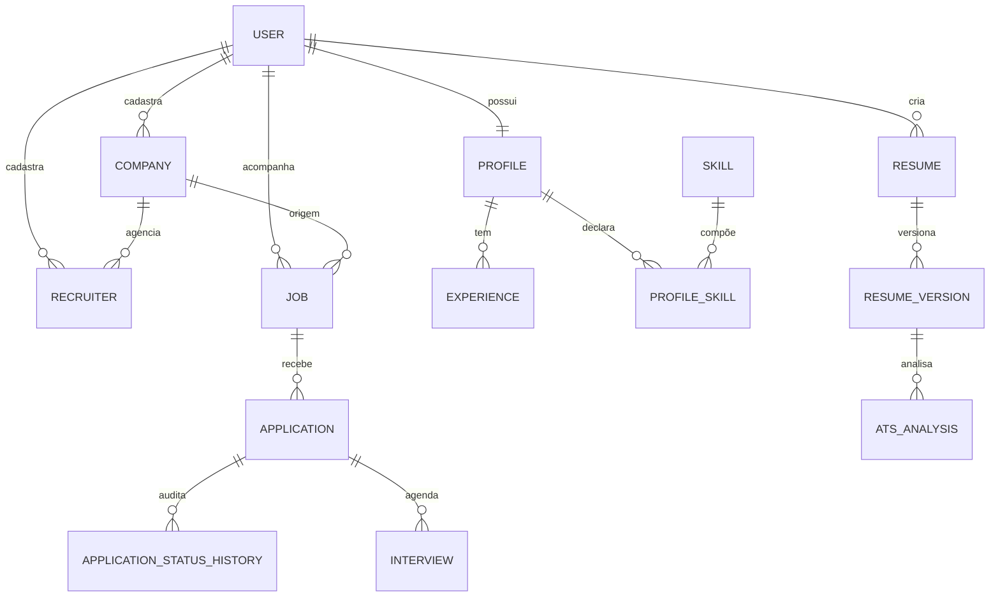
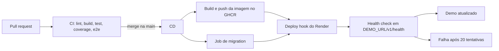

# Kandid

**API REST para organizar a busca por emprego: perfil estruturado, currículos versionados, análise ATS determinística e pipeline de candidaturas.**


## Visão geral

Quem procura emprego costuma espalhar informações entre planilhas, currículos em
pastas, e-mails e anotações. O resultado é perda de contexto, versões conflitantes
de currículo e pouca visibilidade sobre o que está funcionando no processo.

O Kandid propõe centralizar esse fluxo em uma única API:

- perfil profissional estruturado, com experiências, skills, formação,
  certificações e idiomas;
- currículos com versões imutáveis, geradas a partir do perfil;
- análise de aderência a uma vaga com motor ATS determinístico e explicável;
- candidaturas com status, histórico auditável, entrevistas e valores
  propostos/ofertados;
- métricas de funil e de compensação.

É um projeto **pessoal, de estudo e portfólio**, sem objetivo comercial. A
especificação completa do domínio está em [`docs/prompt-kandid.md`](docs/prompt-kandid.md).

> **Estado atual:** o projeto está na Sprint 0 (fundação). Já existem a aplicação
> NestJS, a conexão com MySQL, o health check e o Swagger. Os endpoints de
> autenticação e de domínio ainda não foram implementados; consulte
> [Status atual](#status-atual-sprint-0) e [Roadmap](#roadmap-por-sprints).

## Escopo do MVP

O escopo abaixo é o alvo do MVP definido na spec. A implementação é incremental,
por sprint.

### Dentro do escopo

- Autenticação simples com JWT: registro, login e `GET /me`.
- Perfil, experiências com bullets, skills, formação, certificações e idiomas.
- Empresas (cliente ou agência), recrutadores e vagas.
- Candidaturas com máquina de estados, histórico append-only e entrevistas.
- Currículos com versões imutáveis em snapshot JSON.
- Motor ATS determinístico, sem IA, com score e breakdown explicáveis.
- Export do currículo em JSON e HTML.
- Dashboard com funil, taxa de resposta e comparativo proposto × ofertado.
- Seed do catálogo de skills e seed de demonstração.
- Swagger, migrations, Docker Compose e documentação.

### Fora de escopo

- Geração de PDF ou DOCX.
- Integração com LLM ou qualquer recurso de IA.
- Billing, planos, multi-tenant, convites ou times.
- Upload e armazenamento de arquivos.
- Importação de currículo existente.
- Parsing automático de vaga por URL.
- Roles e permissões além de "usuário autenticado".
- Telemetria da aplicação.

## Stack e decisões técnicas

| Camada | Escolha |
|---|---|
| Runtime | Node.js 24 (CI e imagem Docker) |
| Framework | NestJS 12 |
| Linguagem | TypeScript strict, ESM (`"type": "module"`, imports relativos com `.js`) |
| Persistência | TypeORM 1.1.2 com driver `mysql2` |
| Banco | MySQL 8.4 (Docker Compose local e service container no CI) |
| Documentação | Swagger/OpenAPI em `/docs` |
| Validação | `class-validator` + `class-transformer` com `ValidationPipe` global |
| Testes | Vitest + supertest |
| Qualidade | oxlint type-aware + Prettier |
| Entrega | Docker multi-stage, GHCR, GitHub Actions e Render (demo pendente) |

Decisões que moldam o código:

- **ESM**: todo import relativo termina em `.js`; não há `require()`.
- **Prefixo global `/v1`**: a API fica em `/v1`; o Swagger fica em `/docs`.
- **Schema versionado**: `synchronize: false` e migrations versionadas. Em
  ambiente remoto, migrations são forward-only.
- **Configuração validada no boot**: o `ConfigModule` valida as variáveis de
  ambiente e falha cedo se algo estiver incorreto. `DATABASE_URL` tem prioridade
  sobre `DB_*`, e `JWT_SECRET` precisa ter pelo menos 16 caracteres.
- **Erros com formato único**: `{ statusCode, error, message, path, timestamp }`
  via filtro global de exceções.
- **Domínio escopado por usuário**: toda consulta de domínio deve usar o
  `user_id` do usuário autenticado; `user_id` nunca é aceito no body.
- **Dinheiro em centavos**: valores monetários usam `bigint`, sempre acompanhados
  de `currency` e `salary_period`.
- **Imutabilidade**: `resume_version` e `application_status_history` não sofrem
  `UPDATE`; versões e histórico são registros append-only.
- **ATS determinístico**: o score é calculado por regras explícitas e testáveis,
  com pesos, checks estruturais e keywords encontradas/ausentes. Não há IA.

## Arquitetura

Monólito modular em NestJS. Hoje a aplicação tem apenas a fundação:

- `main.ts` configura o prefixo `/v1`, o `ValidationPipe`, CORS, o Swagger e a
  porta;
- `app.module.ts` carrega configuração validada, TypeORM e o módulo de health;
- `database/data-source.ts` é o `DataSource` usado pelo CLI do TypeORM, com
  entidades e migrations carregadas por glob;
- `health` executa `SELECT 1` para reportar o estado do banco;
- `common/filters` concentra o filtro global de erros.

Os módulos de domínio serão criados em `src/modules/` seguindo o padrão
`dto/`, `entities/`, `*.module.ts`, `*.controller.ts`, `*.service.ts` e
`*.spec.ts`.

```text
Kandid/
├── .github/
│   ├── workflows/
│   │   ├── ci.yml
│   │   ├── cd.yml
│   │   └── codeql.yml
│   ├── CODEOWNERS
│   ├── dependabot.yml
│   └── pull_request_template.md
├── .opencode/
│   ├── agents/                  # 8 agentes do time
│   └── commands/                # /sprint-plan, /feature, /test, /review, /release, /retro
├── docs/
│   ├── adr/
│   │   └── 0001-database.md
│   ├── sprints/
│   │   └── sprint-00.md
│   ├── backlog.md
│   ├── prompt-kandid.md         # spec e fonte da verdade do domínio
│   ├── runbook-deploy.md
│   └── workflow.md
├── kandid_api/
│   ├── src/
│   │   ├── common/filters/
│   │   ├── config/
│   │   ├── database/
│   │   │   ├── data-source.ts
│   │   │   └── migrations/
│   │   ├── health/
│   │   ├── app.controller.ts
│   │   ├── app.module.ts
│   │   └── main.ts
│   ├── test/
│   ├── docker-compose.yml
│   ├── Dockerfile
│   ├── .env.example
│   ├── package.json
│   └── vitest.config*.ts
├── AGENTS.md
├── README.md
└── opencode.jsonc
```

### Modelo de domínio alvo

Visão simplificada do modelo definido na spec. As entidades ainda não existem no
banco; a primeira migration de domínio nasce na Sprint 1.



## Como rodar localmente

Pré-requisitos:

- Node.js 24 e npm;
- Docker com Docker Compose.

Execute a partir de `kandid_api/`:

```bash
cd kandid_api
docker compose up -d
docker compose ps          # aguarde o MySQL ficar healthy
cp .env.example .env
# edite .env e troque JWT_SECRET por um valor aleatório com 16+ caracteres
npm ci
npm run migration:run
npm run start:dev
```

No Windows/PowerShell, o equivalente ao `cp` é:

```powershell
Copy-Item .env.example .env
```

O `docker-compose.yml` sobe MySQL 8.4 em `localhost:3306`, com banco `kandid` e
usuário/senha `kandid`. Essas credenciais são apenas para desenvolvimento local.

Nesta fase não há migrations de domínio. O `migration:run` valida a conexão e
registra a tabela de controle `migrations`; a primeira migration nasce na Sprint 1.

URLs locais:

| URL | O que é |
|---|---|
| http://localhost:3000/v1 | Metadados da API |
| http://localhost:3000/v1/health | Saúde da aplicação e do banco |
| http://localhost:3000/docs | Swagger UI |

Para parar o banco:

```bash
docker compose down
# use "docker compose down -v" para apagar também o volume local
```

## Endpoints disponíveis

Esta tabela reflete o estado atual do código. Rotas de autenticação e domínio
ainda não estão implementadas.

| Método | Rota | Descrição |
|---|---|---|
| `GET` | `/v1` | Metadados: nome, versão e links de documentação e health |
| `GET` | `/v1/health` | Status da aplicação, versão, uptime e conexão com o banco |
| `GET` | `/docs` | Swagger UI (não faz parte do prefixo `/v1`) |

### Exemplos com `curl`

Metadados:

```bash
curl -s http://localhost:3000/v1
```

```json
{
  "name": "Kandid API",
  "version": "0.1.0",
  "docs": "/docs",
  "health": "/v1/health"
}
```

Health:

```bash
curl -s http://localhost:3000/v1/health
```

```json
{
  "status": "ok",
  "version": "0.1.0",
  "timestamp": "2026-11-05T12:00:00.000Z",
  "uptime": 42,
  "services": {
    "database": "up"
  }
}
```

`timestamp` e `uptime` variam a cada chamada. Se o banco não responder, a resposta
continua com HTTP 200, mas com `status: "degraded"` e `services.database: "down"`.

Swagger:

```bash
curl -s -o /dev/null -w "%{http_code}\n" http://localhost:3000/docs
# 200
```

## Scripts npm

Execute todos dentro de `kandid_api/`.

| Script | O que faz |
|---|---|
| `npm run build` | Compila a aplicação com `nest build` |
| `npm run start` | Sobe a aplicação sem watch |
| `npm run start:dev` | Sobe em modo watch |
| `npm run start:debug` | Sobe em modo debug com watch |
| `npm run start:prod` | Executa `node dist/main.js` |
| `npm run lint` | Roda oxlint type-aware em `src/` e `test/` |
| `npm run format` | Formata com Prettier |
| `npm test` | Roda os testes unitários com Vitest |
| `npm run test:watch` | Roda testes unitários em watch |
| `npm run test:cov` | Roda testes unitários com cobertura |
| `npm run test:e2e` | Roda os testes e2e com Vitest e supertest |
| `npm run migration:generate -- src/database/migrations/Nome` | Gera uma migration a partir das entidades |
| `npm run migration:run` | Aplica as migrations pendentes |
| `npm run migration:show` | Lista migrations e status |
| `npm run migration:revert` | Reverte a última migration (apenas local) |

O deploy do ambiente demo é feito pelo workflow `cd.yml`, não por um script npm.

## Testes e qualidade

Os testes usam Vitest com globals e supertest:

| Suíte | Arquivo | Testes atuais |
|---|---|---|
| Unitário — metadados | `src/app.controller.spec.ts` | 1 |
| Unitário — health | `src/health/health.controller.spec.ts` | 2 |
| Unitário — validação de env | `src/config/env.validation.spec.ts` | 8 |
| Unitário — filtro de erros | `src/common/filters/all-exceptions.filter.spec.ts` | 3 |
| E2E — API, health e erro | `test/app.e2e-spec.ts` | 3 |

Os testes unitários cobrem os arquivos `*.spec.ts`. Os testes e2e usam
`*.e2e-spec.ts` e exigem um MySQL acessível: Docker Compose local ou o service
container do CI.

Comandos de verificação:

```bash
cd kandid_api
npm run lint
npm run build
npm test
npm run test:cov
npm run test:e2e   # exige MySQL
```

O CI roda `lint`, `build`, `test`, `coverage` e `e2e` em jobs separados. O `e2e`
executa `npm run migration:run` antes dos testes, com MySQL 8.4 como service
container.

## CI/CD e deploy

| Workflow | Gatilho | O que faz |
|---|---|---|
| `ci.yml` | Pull request para `main` e push na `main` | Jobs `lint`, `build`, `test`, `coverage` e `e2e` com Node.js 24 e cache do npm |
| `codeql.yml` | Push/PR na `main` e cron semanal | Análise CodeQL para `javascript-typescript` |
| `cd.yml` | Push na `main`, tag `v*` e `workflow_dispatch` | Build/push da imagem no GHCR, migration, deploy hook do Render e health check |
| `dependabot.yml` | Semanal | Atualizações de npm, GitHub Actions e Docker |



Detalhes do CD:

- a imagem é publicada em `ghcr.io/<owner>/<repo>/kandid-api`, com tags `sha`,
  `latest` e, em releases `v*`, a versão SemVer (`<owner>/<repo>` são as
  coordenadas do repositório no GitHub);
- o job de migration usa o environment `demo`, `DATABASE_URL` e `DB_SSL=true`;
- o deploy chama `RENDER_DEPLOY_HOOK_URL` e consulta `DEMO_URL/v1/health` por até
  20 tentativas, com 15 segundos entre elas, exigindo `status: ok` e
  `services.database: up`;
- se `RENDER_DEPLOY_HOOK_URL` ou `DEMO_URL` não estiverem configurados, o workflow
  falha explicitamente.

**O demo público ainda não está configurado.** O CD está implementado, mas o
caminho até `Demo atualizado` depende de infraestrutura manual (Render, banco e
secrets). O banco do ambiente demo também está pendente: o
[ADR 0001](docs/adr/0001-database.md) está em `Proposed` e recomenda **TiDB Cloud
Serverless** (compatível com MySQL), com fallback para **Neon/Postgres** se o
spike falhar nos critérios definidos.

Passos manuais e operação estão no
[runbook de deploy](docs/runbook-deploy.md). Resumo:

- [ ] Criar o repositório no GitHub e configurar o remote.
- [ ] Proteger a `main` com PR obrigatório e checks `lint`, `build`, `test`.
- [ ] Criar o environment `demo` no GitHub.
- [ ] Criar o serviço no Render com health check em `/v1/health`.
- [ ] Criar o banco do demo e liberar acesso do runner e do Render.
- [ ] Cadastrar `DATABASE_URL`, `JWT_SECRET` e `RENDER_DEPLOY_HOOK_URL`; configurar
      a variable `DEMO_URL`.
- [ ] Validar o primeiro CI em um PR e o primeiro deploy após merge.

## Time de agentes e fluxo de trabalho

O desenvolvimento é assistido por um time de 8 agentes OpenCode, descrito em
[`docs/workflow.md`](docs/workflow.md):

| Agente | Responsabilidade |
|---|---|
| `tech-lead` | Orquestra, decompõe, delega e consolida |
| `product-owner` | Backlog, histórias e critérios de aceite |
| `architect` | Modelo, contratos, ADRs e riscos |
| `backend-dev` | Implementação e migrations |
| `qa-engineer` | Testes e validação |
| `code-reviewer` | Revisão read-only |
| `devops-engineer` | Docker, CI, CD e runbooks |
| `tech-writer` | README, ADRs e relatórios |

O ciclo de uma sprint é: escopo aprovado, build em branches curtas, testes,
revisão, validação humana, merge/deploy e retrospectiva. Os comandos disponíveis
são `/sprint-plan`, `/feature`, `/test`, `/review`, `/release` e `/retro`.

O humano aprova **escopo, commit, merge e deploy**. Nenhum agente faz `git push`,
merge, release ou deploy por conta própria. Commits seguem Conventional Commits e
branches curtas seguem o padrão `feat/KAN-12-descricao`.

## Roadmap por sprints

Sprints são fases, não calendário: cada uma fecha quando o Definition of Done é
atingido. O detalhamento está em [`docs/backlog.md`](docs/backlog.md).

| Sprint | Foco | Status |
|---|---|---|
| 0 | Fundação, agentes e CI/CD | Em andamento |
| 1 | Autenticação: registro, login e `GET /me` | Planejado |
| 2 | Perfil: experiências, skills, formação, certificações e idiomas | Planejado |
| 3 | Empresas, recrutadores e vagas | Planejado |
| 4 | Candidaturas e máquina de estados | Planejado |
| 5 | Currículos, versionamento e motor ATS | Planejado |
| 6 | Export JSON/HTML, entrevistas e dashboards | Planejado |
| 7 | Seed de demonstração, hardening e release `v1.0.0` | Planejado |

## Status atual (Sprint 0)

**Sprint 0 — Fundação, agentes e CI/CD**, iniciada em 2026-11-05 e em andamento.
O objetivo é o walking skeleton: repositório organizado, configuração validada,
health check, banco versionado, CI e deploy automático no demo.

Concluído:

- monorepo com `kandid_api/`, `docs/`, `.github/` e `.opencode/`;
- 8 agentes e 6 comandos configurados;
- configuração de ambiente validada, TypeORM com `synchronize: false` e CLI de
  migration funcional;
- Swagger em `/docs`, validação global e filtro de erros;
- `GET /v1` e `GET /v1/health` locais;
- workflows de CI, CD e CodeQL criados;
- ADR 0001 registrado como `Proposed`;
- README de portfólio (este documento).

Validação local registrada em 2026-11-05:

| Verificação | Resultado |
|---|---|
| `npm run lint` | Verde, sem warnings |
| `npm run build` | Verde |
| `npm test` | 4 arquivos, 14 testes |
| `npm run test:e2e` | 1 arquivo, 3 testes |
| `npm run migration:run` | Conecta ao MySQL e registra a tabela `migrations` |
| `GET /v1` | 200 com metadados |
| `GET /v1/health` | 200 com `database: up` |
| `GET /docs` | 200 com Swagger UI |
| `docker build` + execução | imagem conecta ao MySQL e responde `/v1/health` com `database: up` |

Pendências:

- **CI em PR:** workflows criados, mas ainda não executaram em um PR real porque o
  repositório remoto não foi configurado.
- **CD e demo:** KAN-7 bloqueado por infraestrutura manual (Render, banco,
  secrets). Não há URL pública.
- **Banco do demo:** KAN-8 bloqueado por conta externa; decisão do ADR 0001
  pendente do spike.
- **Primeira migration de domínio:** nasce na Sprint 1, junto com as entidades de
  autenticação e perfil.
- **Tarefas humanas do Sprint 0:** repositório remoto, proteção da `main`,
  environment `demo`, serviço no Render, banco, secrets e health check.

## Documentação

- [`docs/prompt-kandid.md`](docs/prompt-kandid.md) — spec completa do domínio.
- [`docs/backlog.md`](docs/backlog.md) — épicos, histórias e status.
- [`docs/workflow.md`](docs/workflow.md) — time, ciclo de sprint e portões humanos.
- [`docs/sprints/sprint-00.md`](docs/sprints/sprint-00.md) — escopo e validação da
  Sprint 0.
- [`docs/adr/0001-database.md`](docs/adr/0001-database.md) — decisão de banco do
  ambiente demo.
- [`docs/runbook-deploy.md`](docs/runbook-deploy.md) — deploy, migrations e
  rollback.

## Licença e aviso

Não há arquivo `LICENSE` nem licença definida para este projeto. O
`kandid_api/package.json` declara `"private": true` e `"license": "UNLICENSED"`.

Este é um projeto pessoal de estudo e portfólio, sem objetivo comercial. Não há
concessão de licença para reutilização; entre em contato com o autor antes de usar
o código em outro projeto.
